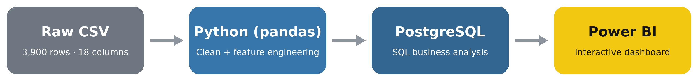

<div align="center">

# 🛍️ Customer Shopping Behavior Analysis

### An end-to-end data analytics project: Python → PostgreSQL → Power BI


</div>

---

## 📑 Table of Contents

1. [Project Overview](#-project-overview)
2. [Business Problem & Objectives](#-business-problem--objectives)
3. [Tech Stack](#-tech-stack)
4. [Project Architecture](#-project-architecture)
5. [Dataset](#-dataset)
6. [Step 1: Data Cleaning & Feature Engineering (Python)](#-step-1-data-cleaning--feature-engineering-python)
7. [Step 2: Loading Data into PostgreSQL](#-step-2-loading-data-into-postgresql)
8. [Step 3: SQL Business Analysis](#-step-3-sql-business-analysis)
9. [Step 4: Power BI Dashboard](#-step-4-power-bi-dashboard)
10. [Key Insights](#-key-insights)
11. [Business Recommendations](#-business-recommendations)
12. [How to Run This Project](#-how-to-run-this-project)
13. [Limitations](#-limitations)
14. [Future Improvements](#-future-improvements)
15. [Skills Demonstrated](#-skills-demonstrated)
16. [Acknowledgements](#-acknowledgements)
17. [Author & Contact](#-author--contact)

---

## 📌 Project Overview

Understanding *who* buys, *what* they buy, and *why they come back* is at the core of every retail business. This project analyses the shopping behaviour of **3,900 customers** across **4 product categories, 25 items and 50 locations**.

The project follows the full analytics lifecycle used by real data teams:

1. **Clean and prepare** raw data with Python (pandas)
2. **Store** it in a relational database (PostgreSQL)
3. **Query** it with SQL to answer specific business questions
4. **Visualise** the results in an interactive Power BI dashboard
5. **Translate** the findings into business recommendations

---

## 🎯 Business Problem & Objectives

A retail company wants to better understand its customers in order to improve marketing, pricing, and loyalty strategy. This analysis aims to answer questions such as:

- Which customer groups (gender, age) generate the most revenue?
- Do **subscribers** spend more than non-subscribers?
- Are **discounts** working, and which products depend on them most?
- Does the **shipping type** influence how much customers spend?
- Which products are the most popular and best rated?
- How loyal are customers, and are repeat buyers more likely to subscribe?

---

## 🧰 Tech Stack

| Stage | Tool | Purpose |
|---|---|---|
| Data cleaning & feature engineering | **Python** (pandas) in **Jupyter Notebook** | Handle missing values, rename columns, create new features |
| Database connection | **SQLAlchemy**, **psycopg2** | Load the cleaned DataFrame into PostgreSQL |
| Data storage | **PostgreSQL** (pgAdmin) | Relational storage of the cleaned data |
| Analysis | **SQL** | Aggregations, `CASE` logic, CTEs, subqueries, window functions |
| Visualisation | **Power BI** | Interactive dashboard with KPIs, charts and slicers |

---

## 🏗️ Project Architecture

<p align="center">
  
</p>

---

## 📊 Dataset

| Property | Value |
|---|---|
| Rows | 3,900 |
| Columns | 18 (19 after feature engineering, once `promo_code_used` is dropped and 2 features are added) |
| Customers' age range | 18 – 70 (average ≈ 44) |
| Purchase amount range | $20 – $100 (average ≈ $59.76) |
| Review rating range | 2.5 – 5.0 (average ≈ 3.75) |
| Categories | 4 (Clothing, Footwear, Accessories, Outerwear) |
| Unique items | 25 |
| Unique locations | 50 (US states) |
| Source | *(add the dataset link here, e.g. Kaggle)* |

### Data Dictionary

| Column | Description |
|---|---|
| `customer_id` | Unique customer identifier |
| `age` | Customer age |
| `gender` | Male / Female |
| `item_purchased` | Product bought (25 unique items, e.g. Blouse, Sweater, Jeans, Sandals) |
| `category` | Product category |
| `purchase_amount` | Purchase value in USD (renamed from `Purchase Amount (USD)`) |
| `location` | US state of the customer |
| `size` | Item size (S, M, L, XL) |
| `color` | Item colour (25 unique colours) |
| `season` | Season of purchase (Spring, Summer, Fall, Winter) |
| `review_rating` | Customer rating from 2.5 to 5.0 |
| `subscription_status` | Whether the customer is a subscriber (Yes / No) |
| `shipping_type` | Shipping method (6 types, e.g. Express, Standard, Free Shipping, Next Day Air) |
| `discount_applied` | Whether a discount was applied (Yes / No) |
| `previous_purchases` | Number of earlier purchases (1 – 50) |
| `payment_method` | Payment method (6 types, e.g. PayPal, Credit Card, Venmo, Cash) |
| `frequency_of_purchases` | How often the customer buys (7 values, e.g. Weekly, Monthly, Quarterly) |
| `age_group` | **Engineered:** age quartile group |
| `purchase_frequency_days` | **Engineered:** purchase frequency converted to number of days |

---

## 🐍 Step 1: Data Cleaning & Feature Engineering (Python)

📓 Notebook: [`Customer_Shopping_Behavior_Analysis.ipynb`](Customer_Shopping_Behavior_Analysis.ipynb)

### 1.1 Data inspection
I used `df.head()`, `df.info()` and `df.describe(include='all')` to understand the structure, data types and summary statistics.

### 1.2 Missing values
Only one column had missing data: **`Review Rating` (37 missing values out of 3,900)**. Dropping those rows would waste good data, and using the overall mean would ignore differences between product types. So I filled each missing rating with the **median rating of that product's category**:

```python
df['Review Rating'] = df.groupby('Category')['Review Rating'] \
                        .transform(lambda x: x.fillna(x.median()))
```

### 1.3 Column naming
Column names were standardised to `snake_case` so they are easier to use in SQL and Power BI:

```python
df.columns = df.columns.str.lower()
df.columns = df.columns.str.replace(' ', '_')
df = df.rename(columns={'purchase_amount_(usd)': 'purchase_amount'})
```

### 1.4 Feature engineering

**`age_group`**: customers were split into four equal-sized groups with quartile binning:

```python
labels = ['Young Adult', 'Adult', 'Middle-aged', 'Senior']
df['age_group'] = pd.qcut(df['age'], q=4, labels=labels)
```

**`purchase_frequency_days`**: the text frequency was converted into a numeric number of days so it can be analysed and compared:

```python
frequency_mapping = {
    'Weekly': 7, 'Fortnightly': 14, 'Bi-Weekly': 14, 'Monthly': 30,
    'Quarterly': 90, 'Every 3 Months': 90, 'Annually': 365
}
df['purchase_frequency_days'] = df['frequency_of_purchases'].map(frequency_mapping)
```

### 1.5 Removing redundant data
`discount_applied` and `promo_code_used` were checked and found **identical in every single row**:

```python
(df['discount_applied'] == df['promo_code_used']).all()   # True
```

Keeping duplicate information adds noise, so `promo_code_used` was dropped.

---

## 🗄️ Step 2: Loading Data into PostgreSQL

The cleaned DataFrame was loaded into a PostgreSQL database (`customer_behavior`) as a table named `customer` using SQLAlchemy.

```python
import os
from sqlalchemy import create_engine

username = "postgres"
password = os.environ["PG_PASSWORD"]   # never hard-code passwords
host, port, database = "localhost", "5432", "customer_behavior"

engine = create_engine(
    f"postgresql+psycopg2://{username}:{password}@{host}:{port}/{database}"
)
df.to_sql("customer", engine, if_exists="replace", index=False)
```

> 🔒 Credentials are read from an environment variable and are **not** stored in the repository.

---

## 🔎 Step 3: SQL Business Analysis

📄 Full script: [`Customer_Shopping_Behavior_Analysis.sql`](Customer_Shopping_Behavior_Analysis.sql)

Ten business questions were answered using SQL. The techniques used are listed next to each question.

| # | Business Question | SQL Techniques |
|---|---|---|
| 1 | What is the total revenue from male vs. female customers? | `SUM`, `GROUP BY` |
| 2 | Which customers used a discount but still spent more than the average purchase? | Subquery, `AVG`, `WHERE` |
| 3 | What are the top 5 products by average review rating? | `AVG`, `ROUND`, `ORDER BY`, `LIMIT` |
| 4 | How do average purchase amounts compare between Standard and Express shipping? | `IN`, `AVG`, `GROUP BY` |
| 5 | Do subscribers spend more? (average spend and total revenue) | `COUNT`, `AVG`, `SUM`, `GROUP BY` |
| 6 | Which 5 products have the highest percentage of discounted purchases? | `CASE WHEN`, conditional aggregation |
| 7 | Segment customers into New, Returning and Loyal | CTE, `CASE WHEN`, `BETWEEN` |
| 8 | What are the top 3 most purchased products in each category? | CTE, `ROW_NUMBER() OVER (PARTITION BY ...)` |
| 9 | Are repeat buyers (more than 5 previous purchases) also likely to subscribe? | `WHERE`, `COUNT`, `GROUP BY` |
| 10 | What is the revenue contribution of each age group? | `SUM`, `GROUP BY`, `ORDER BY` |

### Example 1: Discount rate by product (conditional aggregation)

```sql
SELECT item_purchased,
       ROUND(100.0 * SUM(CASE WHEN discount_applied = 'Yes' THEN 1 ELSE 0 END)
             / COUNT(*), 2) AS discount_rate
FROM customer
GROUP BY item_purchased
ORDER BY discount_rate DESC
LIMIT 5;
```

### Example 2: Customer segmentation (CTE + CASE)

```sql
WITH customer_type AS (
    SELECT customer_id, previous_purchases,
           CASE
               WHEN previous_purchases = 1 THEN 'New'
               WHEN previous_purchases BETWEEN 2 AND 10 THEN 'Returning'
               ELSE 'Loyal'
           END AS customer_segment
    FROM customer
)
SELECT customer_segment, COUNT(*) AS "Number of Customers"
FROM customer_type
GROUP BY customer_segment;
```

### Example 3: Top 3 products per category (window function)

```sql
WITH item_counts AS (
    SELECT category, item_purchased,
           COUNT(customer_id) AS total_orders,
           ROW_NUMBER() OVER (PARTITION BY category
                              ORDER BY COUNT(customer_id) DESC) AS item_rank
    FROM customer
    GROUP BY category, item_purchased
)
SELECT item_rank, category, item_purchased, total_orders
FROM item_counts
WHERE item_rank <= 3;
```

---

## 📈 Step 4: Power BI Dashboard

📊 File: [`Customer_Shopping_Behavior_Dashboard.pbix`](Customer_Shopping_Behavior_Dashboard.pbix) *(open with Power BI Desktop)*

The dashboard connects directly to the PostgreSQL `customer` table and presents the key findings on a single interactive page.


### Dashboard components

| Component | What it shows |
|---|---|
| **KPI cards** | Number of customers, average purchase amount, average review rating |
| **Donut chart** | Customers split by subscription status |
| **Column chart** | Total revenue by product category |
| **Column chart** | Number of customers by product category |
| **Bar chart** | Total revenue by age group |
| **Bar chart** | Number of customers by age group |
| **Slicers (filters)** | Category, Subscription status, Gender, Shipping type |

All visuals respond to the slicers, so the audience can explore any customer segment (for example, *female subscribers who chose Express shipping*) and see every chart update instantly.

---

## 💡 Key Insights

### Facts confirmed from the data exploration

- 👥 The dataset is **male-dominated**: about **68%** of customers are male (2,652 of 3,900) and 32% female.
- 🔔 Only about **27%** of customers are subscribers (1,053); roughly **73%** are not subscribed.
- 👕 **Clothing** is the biggest category, with about **45%** of all purchases (1,737 of 3,900).
- 🏷️ About **43%** of purchases had a discount applied (1,677 of 3,900).
- 💵 The **average purchase is about $59.76** (median $60), so spending is fairly evenly spread between $20 and $100.
- ⭐ The **average review rating is about 3.75 out of 5**.
- 🔁 Customers have an average of **25 previous purchases**, which suggests a fairly experienced customer base.
- 🧹 `promo_code_used` was an exact duplicate of `discount_applied`, which is a useful data-quality finding.

### Findings from the SQL analysis

> ✍️ **Replace the `...` below with your own numbers from your SQL results and dashboard.**

| Question | Finding |
|---|---|
| **Revenue by gender** | ... customers generate **$...** (...% of revenue) vs. **$...** for ... |
| **Subscribers vs. non-subscribers** | Subscribers spend an average of **$...** vs. **$...** for non-subscribers, with total revenue of **$...** vs. **$...** |
| **Shipping type** | Express shipping customers spend **$...** on average vs. **$...** for Standard |
| **Top-rated products** | The highest-rated products are ..., ..., ... |
| **Discount dependence** | Products with the highest discount rates: ..., ..., ... (up to ...%) |
| **Customer segments** | ...% New, ...% Returning, ...% Loyal |
| **Repeat buyers & subscription** | Of repeat buyers, **...** are subscribed and **...** are not |
| **Revenue by age group** | The **...** group contributes the most revenue (**$...**, ...%) |
| **Top products per category** | Best sellers: Clothing → ..., Footwear → ..., Accessories → ..., Outerwear → ... |

---

## ✅ Business Recommendations

> ✍️ **Adapt these to match your real results.** They are written as examples of the format recruiters like to see: *insight → action*.

1. **Grow the subscriber base.** Only about 27% of customers subscribe. If subscribers spend more (check Q5), offer a first-month perk or a free-shipping benefit to convert regular buyers.
2. **Target loyal customers.** With many customers having 10+ previous purchases, introduce a loyalty or rewards programme and early access to new products to keep them engaged.
3. **Use discounts more strategically.** Discounts are applied to roughly 43% of purchases. Review the products with the highest discount rates (Q6) and test whether they would sell without a discount.
4. **Close the gender gap.** With roughly two-thirds of customers male, run targeted campaigns and range extensions to reach female customers.
5. **Focus marketing on the highest-revenue age group** (Q10) while developing campaigns to grow the weaker groups.
6. **Promote best-rated products** (Q3) in marketing and use the best sellers per category (Q8) as anchor products for bundles.

---

## ▶️ How to Run This Project

### Prerequisites
- Python 3.8+
- PostgreSQL and pgAdmin
- Power BI Desktop (Windows)

### Steps

**1. Clone the repository**
```bash
git clone https://github.com/YOUR-USERNAME/customer-shopping-behavior-analysis.git
cd customer-shopping-behavior-analysis
```

**2. Install the Python dependencies**
```bash
pip install -r requirements.txt
```

**3. Create the database** in pgAdmin (or psql):
```sql
CREATE DATABASE customer_behavior;
```

**4. Set your database password as an environment variable**

Windows (PowerShell):
```powershell
$env:PG_PASSWORD = "your_password"
```
macOS / Linux:
```bash
export PG_PASSWORD="your_password"
```

**5. Run the notebook** (`jupyter notebook`) from top to bottom. It cleans the data and loads it into the `customer` table.

**6. Run the SQL queries** from `SQL.sql` in pgAdmin to reproduce the analysis.

**7. Open the dashboard.** Open the `.pbix` file in Power BI Desktop. If prompted, update the PostgreSQL connection (server `localhost`, database `customer_behavior`) and refresh.

---

## ⚠️ Limitations

- **No date column.** The dataset has no purchase date, so trend and time-series analysis (monthly sales, growth) are not possible.
- **One row per customer.** Customer behaviour over time and true customer lifetime value cannot be measured.
- **Likely synthetic data.** The dataset appears evenly distributed, so findings illustrate analytical technique rather than real market conclusions.
- **Imputation.** 37 missing ratings (about 0.9%) were filled with category medians, which is reasonable but still an assumption.
- **Correlation, not causation.** Differences between groups (for example subscribers vs. non-subscribers) do not prove that one factor causes the other.

---

## 🚀 Future Improvements

- Add **statistical tests** (t-test, chi-square) to check whether group differences are significant.
- Build a **customer segmentation model** (K-Means clustering) using age, spend, previous purchases and frequency.
- Build a **predictive model** for subscription status (logistic regression / random forest).
- Add **visual EDA** in Python (matplotlib / seaborn) to the notebook.
- Extend the dashboard with a **geographic map** of revenue by state and a **season** analysis.
- Add **DAX measures** such as revenue share, discount rate and subscription rate.
- Automate the pipeline with a Python script and scheduled refresh.

---

## 🏆 Skills Demonstrated

- **Data cleaning:** missing-value imputation, redundancy detection, standardised naming
- **Feature engineering:** quartile binning, mapping categorical text to numeric values
- **Python:** pandas, groupby/transform, SQLAlchemy
- **SQL:** aggregations, subqueries, CTEs, `CASE` logic, window functions
- **Database work:** PostgreSQL setup and Python-to-database loading
- **Data visualisation:** Power BI KPIs, charts, slicers and layout design
- **Business thinking:** turning data into insights and actionable recommendations
- **Good practice:** secure credential handling and clear documentation

---

## 🙏 Acknowledgements

This project was built while following the tutorial: [End-to-End Data Analyst Project (YouTube)](https://www.youtube.com/watch?v=5PrZvPeUw60). The dataset comes from *(add the dataset source here)*.

---

## 👤 Author & Contact

**Your Name**

- 💼 LinkedIn: [your-profile](https://www.linkedin.com/in/your-profile)
- 🐙 GitHub: [@your-username](https://github.com/your-username)
- 📧 Email: your.email@example.com

⭐ If you found this project useful, please consider giving it a star!
